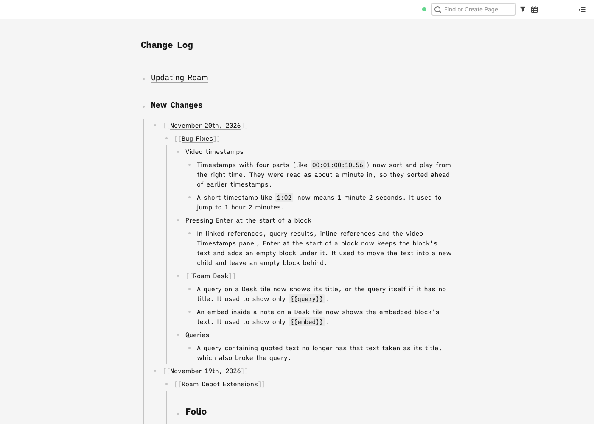
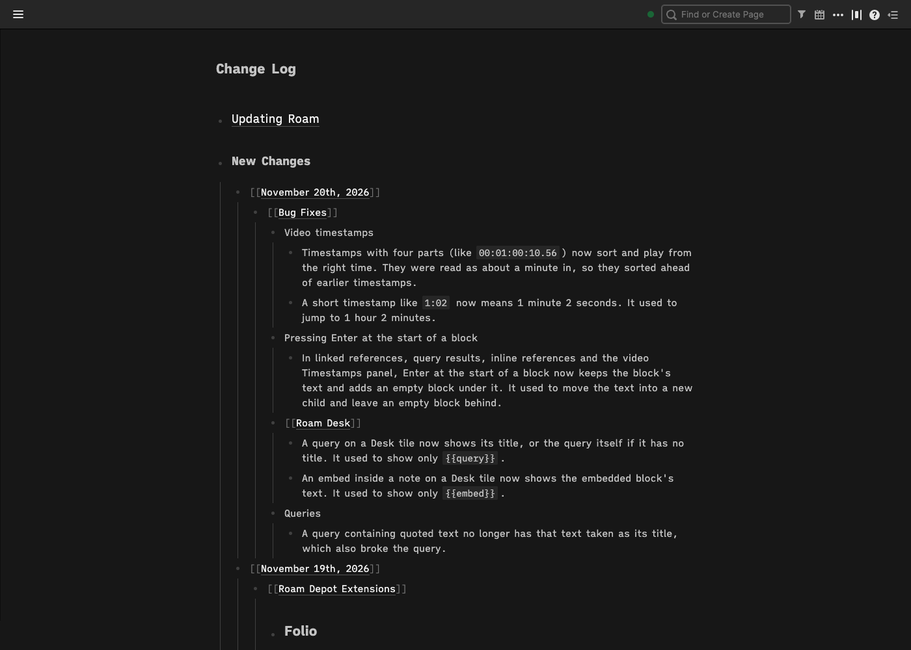
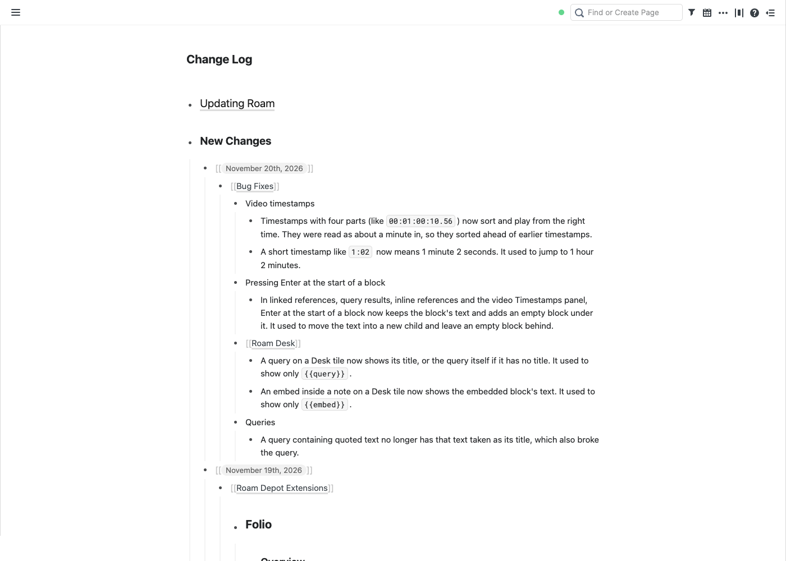
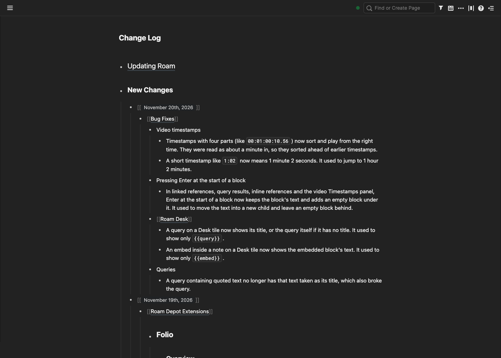
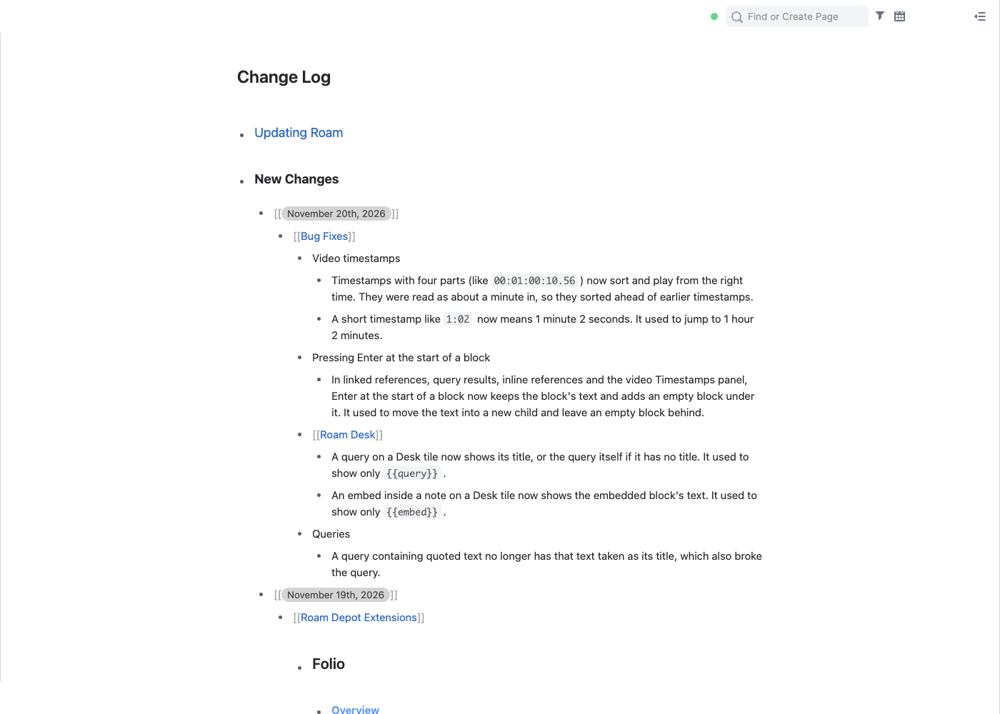
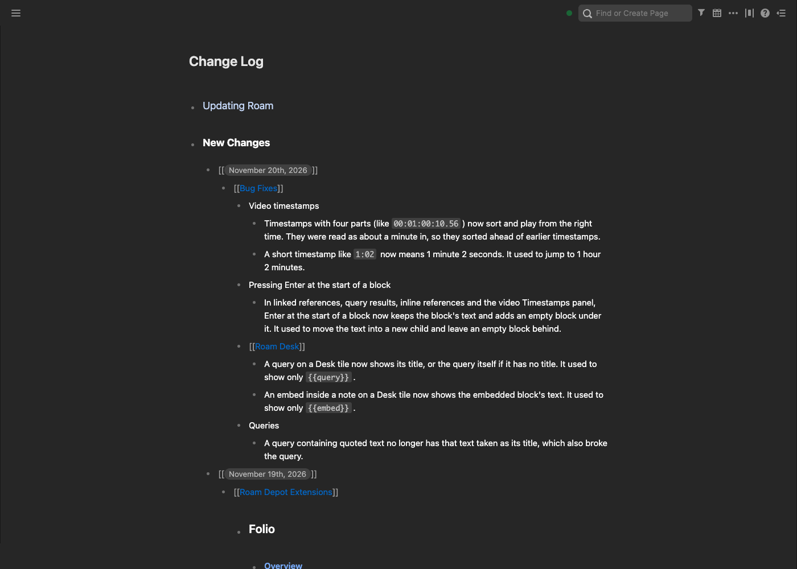
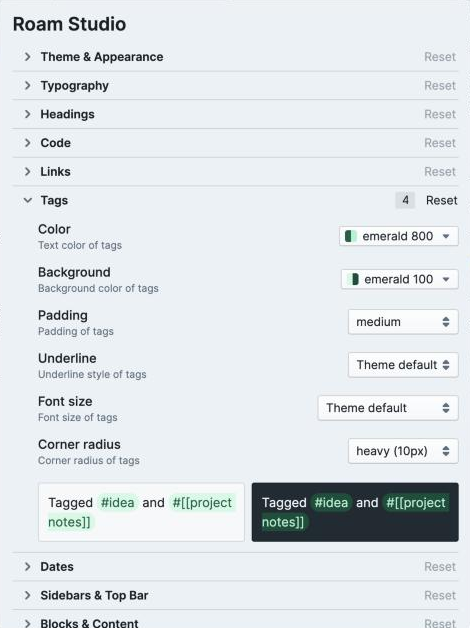

# Roam Studio

Roam Studio gives Roam Research beautiful, consistent themes in light and dark mode, and lets you customize them without writing CSS.

## Important notice

This version is a complete rebuild of Roam Studio. Your previous Roam Studio settings are not carried over: every setting starts at its theme default once.

## Installation

- Disable all other themes, including Blueprint.
- Enable Roam Studio.
- A dark mode toggle button appears in the top bar. Click it to cycle between Auto, Dark and Light.

## Usage

The theme follows your system's light or dark preference by default. Use the top-bar toggle button to switch between:
- **Auto** (follows the system preference)
- **Dark** (always dark)
- **Light** (always light)

## Themes

Choose a theme in the extension's settings in Roam Depot:

- **Theme:** one of
  - **Quattro** (the default): after iA Writer. Neutral grays, iA Writer Quattro S and Mono S, and a light blue accent.
  - **Craft**: after the Craft app. The system font, soft grays, gray tag and date pills, and thick link underlines.
  - **Things**: after the Things app. Blue page links, green tag pills and gray date pills.
  - **Blueprint**: Roam's own BlueprintJS look, consistent in every mode.
  - **Gruvbox**: the Gruvbox color scheme.

  Quattro, Craft and Things reproduce the previous Roam Studio's themes. The fonts they bring (iA Writer, Roboto Mono, Inconsolata) are embedded, so they work offline.

| | Light | Dark |
|---|---|---|
| Quattro |  |  |
| Craft |  |  |
| Things |  |  |
- **Gruvbox contrast:** hard, medium (the default) or soft. It sets the main background and only applies to Gruvbox.

Both settings take effect at once, and the Auto, Dark and Light modes work the same for every theme.

Gruvbox is based on the [Gruvbox color scheme](https://github.com/morhetz/gruvbox) by Pavel Pertsev, MIT licensed.

## Settings

Roam Studio's settings are in its tab of Roam Depot's settings, in groups you open and close: Theme & Appearance, Typography, Headings, Code, Links, Tags, Dates, Sidebars & Top Bar, Blocks & Content, Mobile and Performance. A group's header shows how many of its settings you changed, and **Reset** sets them back to the theme's defaults. Every change applies at once.

Every customization starts at **Theme default**: the active theme decides, and switching themes keeps only what you changed.

### Export and import

**Export** at the top of the settings saves your customization: as a `.json` file (**Download file**) or as text (**Copy to clipboard**). An export holds only the settings you changed, not which groups are open.

**Import** takes such a file or pasted text. Before anything changes, it shows how many settings get a new value and how many go back to their default, and lists entries it skips (an unknown setting or an invalid value). **Apply** replaces your whole customization: settings the export does not name go back to their default, so the result looks exactly like the exported one. Use it to move a look to another graph or device, or to keep a copy before you experiment. Settings of the previous Roam Studio version (`css-…`) cannot be imported.

### Colors

Colors for headings, links, underlines, tags and dates come from a picker: **Theme default**, **Theme accent**, or one of 18 color families (rose to gray) in seven shades. A color you pick for Light gets its counterpart for Dark (shade 1000 − N of the same family), and every swatch shows both halves. Hovering a swatch previews it on the group's samples, which show the elements in Light and Dark side by side; Escape or moving away restores them. A text color with less than 4.5:1 contrast against the page background gets a warning, but you can still use it.

## Modules

Optional tweaks you switch on in the settings, grouped like the settings panel:

- **Sidebars & Top Bar:** hide logo, hide shortcuts heading, hide sidebar icons, masonry sidebar, remove sidebar borders, remove top bar borders, centered search, enhanced search.
- **Blocks & Content:** bullet effects, subtle controls, more room (hide the bullets of empty blocks), strike done todos, dynamic image sizes, dynamic PDF sizes, remove log page minimum height.
- **Mobile:** mobile caret, mobile sidebar.
- **Performance:** disable animations.
- **Headings, Code, Dates:** advanced heading spacing, hide line numbers, no line break within dates.

The **icon theme** can be Roam's BlueprintJS icons or Feather. **Date icons** add a calendar icon before links to daily notes, in the style of the chosen icon theme.

Every module is off until you switch it on, and a module that is off costs nothing. Every font Roam Studio offers works offline: they are embedded, and Inter comes with Roam.

## Requirements

Roam Studio uses the CSS `light-dark()` function for its colors. It needs a current browser engine: Chromium 123+ (the Roam desktop app, Chrome, Edge), Safari 17.5+ (including iOS/iPadOS 17.5+), or Firefox 120+. On older engines, parts of the theme stay uncolored.

## Feature Requests, Bugs, and Feedback

If you have an idea for a new feature or find a bug (e.g., un-themed components in Roam, unusable plugins), file it under [Issues](https://github.com/rcvd/RoamStudio/issues) with a short description and a screenshot.

If you have any additional comments or suggestions, please feel free to send them to [alex@goedel.io](mailto:alex@goedel.io).

## If you want to support my work

- [Become a GitHub Sponsor](https://github.com/sponsors/rcvd)
- [Buy Me a Coffee](https://www.buymeacoffee.com/rcvdio)
- [Become a supporter on gödel.io](https://www.goedel.io/subscribe?utm_medium=web&utm_source=subscribe-widget&utm_content=47299057)
- [Flattr](https://flattr.com/@rcvd)
- [Paypal](https://paypal.me/rcvd)
